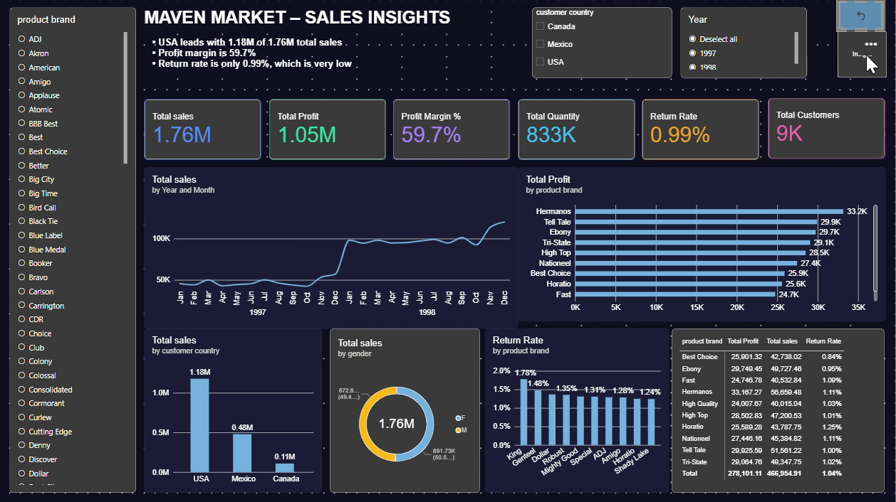
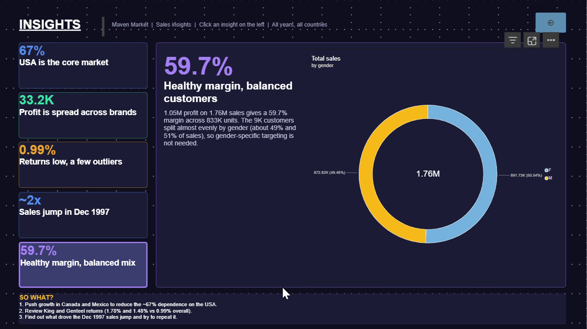

# Maven Market: Sales Insights Dashboard (Power BI)

An interactive Power BI dashboard built on the Maven Market sales dataset (1997-1998), with a click-through **Insights page** that turns the numbers into five key findings.

## Pages

**1. Dashboard**
- KPI cards: Total Sales, Total Profit, Profit Margin %, Total Quantity, Return Rate, Total Customers
- Total sales by year and month (line chart)
- Total profit by product brand (bar chart)
- Total sales by customer country and by gender
- Return rate by product brand, plus a brand-level table
- Slicers for product brand, customer country and year

**2. Insights**
Five buttons on the left, each opening one finding with its own chart. A "So what?" box summarises the recommendations.

## Key findings (all years, all countries)

| Insight | Finding |
|---|---|
| Country concentration | USA contributes 1.18M of the 1.76M total sales (about 67%); Mexico about 0.46M, Canada 0.11M |
| Profit spread | Hermanos leads with 33.2K profit, only about 3% of the 1.05M total; the top 9 brands sit between 24.7K and 33.2K |
| Returns | Overall return rate is 0.99%; King (1.78%) and Genteel (1.48%) are well above average |
| Sales trend | Monthly sales stepped up from about 50K to about 100K from Dec 1997 and stayed high through 1998 |
| Margin and customers | 59.7% profit margin on 833K units; 9K customers with an almost even gender split |

**Recommendations:** grow Canada and Mexico to reduce the dependence on the USA, review returns for King and Genteel, and find out what drove the Dec 1997 jump.

## How the Insights page works
Each insight button is linked to a bookmark that shows or hides that insight's text and chart. The active button is highlighted using a second, highlighted copy of the card.

## Data model
Tables: Calendar, Customers, Products, Regions, Returns, Stores and Transactions.

## Demo
`demo.mp4` shows the filters and the Insights page in action.

## How to open
Download `Maven_Market_Dashboard.pbix` and open it in Power BI Desktop.

## Tools
Power BI, DAX, bookmarks and buttons

## Author
Pranav Verma, [LinkedIn](https://linkedin.com/in/pranav-verma) | [GitHub](https://github.com/Pranav200-lab)
